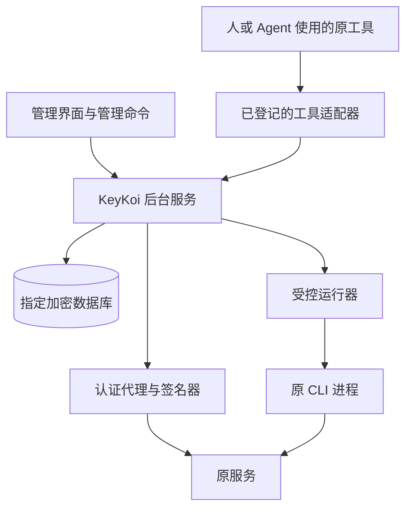
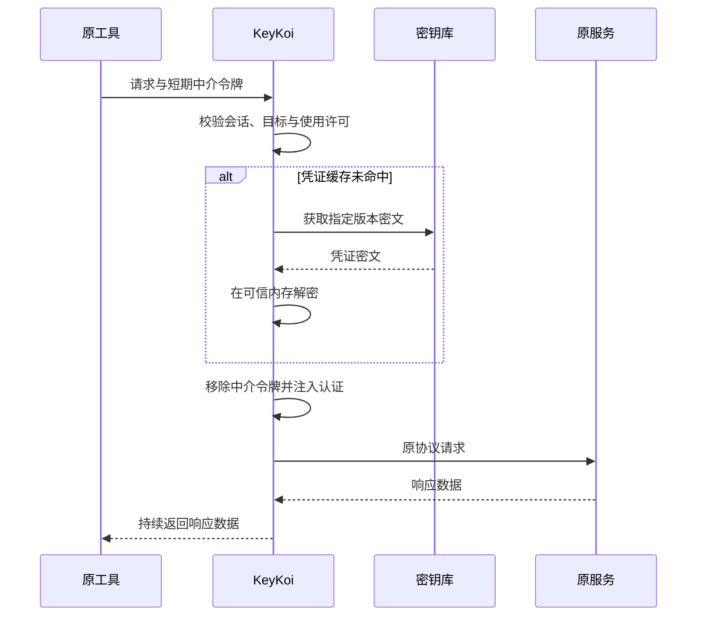

# 钥鲤 KeyKoi：通用密钥中介实现方案

> **钥匙交给钥鲤，工具照常运行。**

- 文档版本：v0.1
- 日期：2026-11-19
- 文档状态：实施设计草案
- 项目代号：KeyKoi，中文名「钥鲤」
- 命名含义：Key + Koi（锦鲤），用一条替工具保管、使用钥匙的小锦鲤作为产品形象。
- 交付范围：产品边界、系统架构、凭证存储、工具适配、接口草案、性能设计、迁移流程与开发验收。本文件中的命令、接口和配置均为拟议设计，尚未实现或实测。

KeyKoi 将分散在配置文件中的业务凭证收拢到一个指定密钥库，由后台服务控制使用和交付。人、Agent、脚本继续使用原来的工具；完成首次接入后，凭证处理尽量在后台完成。

这里的“业务凭证”包括非模型服务的 API Key、AccessKey 组合、数据库密码、OAuth token、SSH 私钥和客户端证书私钥。模型服务 API Key 由调用方自行管理。

> **本轮实施与验收范围**：以当前这台 Mac 的原生 macOS 环境为准。跨平台矩阵描述后续设计目标，Linux 文件专项和 Windows 验收延期。中心与多设备的协议验收在本机通过独立进程完成。执行顺序和验收口径见 [OpenSpec 实施路线图](openspec/roadmap.md)。

## 目录

1. [目标与支持承诺](#1-目标与支持承诺)
2. [产品形态与使用流程](#2-产品形态与使用流程)
3. [总体架构与部署方式](#3-总体架构与部署方式)
4. [最小授权模型与本地接入](#4-最小授权模型与本地接入)
5. [密钥存储与启动解锁](#5-密钥存储与启动解锁)
6. [数据模型](#6-数据模型)
7. [不同工具的适配方式](#7-不同工具的适配方式)
8. [适配器配置规范](#8-适配器配置规范)
9. [接口与命令设计](#9-接口与命令设计)
10. [关键运行流程](#10-关键运行流程)
11. [延迟吞吐与可用性](#11-延迟吞吐与可用性)
12. [迁移轮换撤销与恢复](#12-迁移轮换撤销与恢复)
13. [跨平台实现计划](#13-跨平台实现计划)
14. [技术选型与代码组织](#14-技术选型与代码组织)
15. [测试与验收](#15-测试与验收)
16. [分阶段开发计划](#16-分阶段开发计划)
17. [第一版采用的默认决策](#17-第一版采用的默认决策)
18. [参考资料](#18-参考资料)

## 1. 目标与支持承诺

### 1.1 核心目标

**受托管业务凭证的唯一持久来源是指定数据库；所有使用与交付经过中介控制，尽量减少明文出现的位置和持续时间。**

落实为六项要求：

1. 普通配置文件只保存非敏感设置、凭证引用或助手入口。
2. 真实业务凭证进入 SQL 前先加密；数据库无需直接存储明文。
3. 优先由中介完成认证或签名，原工具无需取得真实密钥。
4. 必须交付真实值时，通过明确登记的运行时适配器完成，并展示交付范围。
5. 日常使用沿用原工具、原命令和原响应格式，不要求 MCP。
6. 中介只管理“谁能使用哪组凭证、采用什么方式、交给哪个目标”，业务权限由原平台决定。

“指定数据库”是逻辑上的唯一权威存储。数据库密文备份、日志和副本属于同一套存储管理范围；本地代理不另建可长期使用的业务密钥缓存文件。

### 1.2 明文可能出现在哪里

| 位置 | 设计要求 |
|---|---|
| 指定数据库及其备份 | 保存凭证密文及解密所需的非秘密元数据 |
| 中介、签名器、受信本机代理的内存 | 在授权期间允许使用真实凭证 |
| 原 CLI 的内存、环境或内存配置文件 | 仅运行时交付模式允许 |
| 普通配置、工作区、日志、命令行参数、模型上下文 | 不主动写入或返回真实业务凭证 |
| 原服务 | 按原认证协议接收 API Key、token 或签名 |
| 操作系统交换、转储、休眠文件 | 根据部署等级控制和验证，不能仅凭“用了内存文件”宣称全部排除 |

这份方案采用“唯一持久来源”的工程定义。普通软件在认证时需要使用解密后的值；运行时内存与持久文件必须分别说明。

### 1.3 支持模式与验证状态分开记录

| 模式 | 原工具是否取得真实凭证 | 典型实现 |
|---|---|---|
| `proxy` | 不主动交付 | HTTP 认证注入、数据库协议代理 |
| `sign` | 取得签名结果，签名密钥由中介持有 | SSH agent、协议签名器 |
| `runtime_delivery` | 会取得 | 凭证助手、子进程环境变量、内存配置文件 |
| 不满足接入条件 | 无法满足选定的持久存储约束 | 工具强制写入不可控制的明文配置或缓存 |

每种模式另外记录验证状态：`planned`、`experimental`、`verified`。验证必须绑定**工具版本、操作系统、适配器版本和运行环境**。不能因一个版本通过测试，就永久认定该工具的所有版本都不会落盘。

对任意已取得真实 key 的程序，KeyKoi 无法保证它绝不复制、输出或发送这个值。对代理模式，也需要把原服务列为可信接收方；若上游主动回显认证字段，不能依赖一次简单文本脱敏证明客户端永远不会见到它。

### 1.4 范围约束

第一版不扩展到以下工作：

- 云平台删除、创建、查询等业务操作授权。
- 单独建立“人”和“Agent”两套身份体系。
- 把原工具的每条业务命令重新封装为 MCP 工具。
- 自动修改所有平台的 IAM、自动轮换所有平台的 key。
- 对任意闭源工具提供零配置、零适配的保证。
- 防御已经完全控制中介宿主的管理员或内核级攻击者。

这些约束让适配工作集中在凭证读取、认证协议和运行环境，而不需要理解每个平台的完整业务 API。

## 2. 产品形态与使用流程

### 2.1 三个用户可见部分

| 部分 | 用途 |
|---|---|
| 管理界面 | 添加和替换凭证、选择工具、查看接入方式和使用记录 |
| 本机后台服务 `keykoid` | 管理会话、解锁密钥库、执行代理认证和运行时交付 |
| 管理命令 `keykoi` | 安装接入、诊断、锁定、撤销；供自动化和无图形环境使用 |

MCP 作为后续可选入口，复用同一套后端能力；安装和日常调用均不依赖它。

### 2.2 首次接入

1. 安装并启动后台服务，初始化指定数据库。
2. 建立解锁方式和本机会话。
3. 用户选择要接入的工具与账户。
4. 适配器识别工具版本及配置位置，展示准备修改的字段。
5. 读取现有凭证，在内存中导入密钥库。
6. 将原配置中的凭证替换为引用、助手入口，或由启动器生成的运行时配置。
7. 完成连接和行为验证，显示接入模式、验证范围和失败原因。

导入界面只显示名称、来源与必要的脱敏信息。真正的凭证输入通过本机受信界面或受控输入通道完成，不要求用户粘贴到 Agent 对话。

### 2.3 日常使用

假设某个工具的原命令是：

```bash
vendor-cli resource list
```

接入完成后，人和 Agent 仍然执行这条命令。不同适配器在后台完成不同工作：

- 配置原生凭证助手的工具，按原协议自动调用助手。
- 可改服务地址的工具，请求自动进入本机认证网关。
- 需要运行环境的工具，通过安装时登记的启动入口运行原二进制。
- 原生签名客户端，通过登记的签名接口申请签名。

对于依赖启动器的工具，需要检测 Agent、非交互 shell、IDE、计划任务是否使用同一个入口。仅配置交互式 shell alias 不足以覆盖这些场景。

### 2.4 接入页应给出的信息

每个工具至少展示：

- 使用哪组凭证、对应哪个账户或环境；
- 接入方式；
- 原工具是否会取得真实凭证；
- 已验证的版本和操作系统；
- 是否要求后台服务解锁；
- 中心断网时的使用期限；
- 最近一次验证和调用状态。

这些信息直接影响使用者的选择，不需要让用户理解内部数据库表或密码算法。

## 3. 总体架构与部署方式

### 3.1 逻辑架构



图中的适配器可以是一项配置、一段原生助手协议，或者受管理启动器，不要求每次都启动一个额外网络服务。

第一版采用一个后台进程承载核心逻辑，按模块组织。需要文件隔离时，再增加权限受限的运行器组件；避免一开始拆成多个微服务。

### 3.2 核心模块

| 模块 | 主要职责 |
|---|---|
| Vault Store | 凭证加解密、版本切换、数据库事务 |
| Session Manager | 本机或设备认证、会话建立与撤销 |
| Grant Evaluator | 校验凭证、交付模式、目标绑定和许可期限 |
| Runtime Broker | 获取同一版本的凭证组合，交给受信执行组件 |
| Adapter Registry | 保存工具适配规则、格式映射及验证结果 |
| HTTP Gateway | 注入认证、校验上游、流式转发 |
| Signer | 按已登记协议生成签名 |
| Process Runner | 设置子进程环境、文件视图和生命周期 |
| Audit | 记录使用元数据，避免记录凭证与敏感请求内容 |
| Integration Manager | 检测、预览、修改、验证和撤销工具配置 |

### 3.3 三种部署方式

| 模式 | 数据库和认证位置 | 优点 | 明确代价 |
|---|---|---|---|
| 单机版 | 指定数据库与后台服务都在本机 | 部署简单，适合首先验证日常体验 | 本机可信服务运行时持有凭证 |
| 中心存储、本机认证 | 中心保存数据库，本机服务取得短期使用许可和所需凭证 | 业务流量直接去原服务，减少绕路 | 本机代理必须进入可信范围；需要缓存失效机制 |
| 中心认证 | 密钥和认证执行均在中心，本机只提交请求或签名任务 | 本机代理不必取得业务密钥 | 有远程认证或转发开销，中心带宽与可用性更重要 |

推荐顺序：先完成单机版，再沿用同一内部接口扩展中心版。多设备之间使用服务 API 通信，不让每个终端直接连接或复制中心数据库。

### 3.4 可信范围

本机普通安装提供集中存储和减少意外暴露的能力。同一操作系统用户下的不同进程，不应自动视为彼此强隔离。

需要进一步限制 Agent 或其他进程读取中介内存时，可以将后台服务放在独立服务账户、受限执行环境或远端。它们是部署方式，不要求产品重新定义“人”和“Agent”的身份。

## 4. 最小授权模型与本地接入

### 4.1 四个核心对象

| 对象 | 含义 |
|---|---|
| Credential | 一组可原子更新的业务凭证 |
| Binding | 某组凭证对应的服务地址、认证方式和适配配置 |
| Session | 已通过中介认证的一次使用会话 |
| UseLease | 某会话在一定时间内通过指定模式使用某个 Binding 的许可 |

授权规则只需要回答：

> 这个已认证会话，能否通过此适配方式使用此组凭证，并向这个登记目标完成认证？

工具名、密钥编号、请求自称的 `caller=human`、Agent 标签都只是元数据，不是身份证明。

### 4.2 本地通信

管理接口和凭证助手优先使用操作系统本地通信：

- Linux：Unix domain socket，校验访问权限及系统提供的对端凭据。
- macOS：使用平台对应的本地连接身份机制，单独实现和验证。
- Windows：命名管道，显式设置用户或登录会话的访问控制。

Linux Unix socket 可以传递进程凭据；Windows 命名管道的默认权限不适合直接作为本产品的最终配置，应显式限制访问。[Linux 文档](https://man7.org/linux/man-pages/man7/unix.7.html)；[Microsoft 文档](https://learn.microsoft.com/en-us/windows/win32/ipc/named-pipe-security-and-access-rights)。

只校验同一用户，不能进一步证明请求一定来自某个具体工具。如果业务需要工具级强隔离，需要给工具安排可验证的运行会话或独立执行环境，而不能只相信传入的程序名。

### 4.3 只能连接 HTTP 的原工具如何认证

原工具未必支持 Unix socket，也未必允许增加自定义认证头。推荐通过受管理启动器建立一个临时使用会话：

1. 启动器通过本地受信连接取得短期随机会话令牌。
2. 将令牌放到原工具已经支持的认证字段中，例如原本的 API Key 字段。
3. 同时把服务地址指向本机网关。
4. 网关识别这个会话令牌，校验目标 Binding 和许可期限。
5. 网关移除中介令牌，再填入原服务的真实凭证。

会话令牌仅通过子进程环境、原生助手或受控内存配置交付，不写入普通持久配置、命令行参数或日志。若工具必须持久保存这个令牌，同样需要运行环境适配，不能把中介令牌视为非敏感占位值。

这个令牌是**受限的中介访问凭证**，仍需保护。它只对 KeyKoi 有效、可到期和撤销，不直接授予原平台访问能力，但泄漏后仍可能在期限内被用来调用中介。

没有受控会话入口的纯 HTTP 工具，不能仅凭 `localhost` 地址和公开占位值获得用钥权。该组合应标记为需要额外接入，避免为了“无感”开放一个所有本地进程都能随意用钥的端口。

首次登录、解锁和工具接入建立授权；正常请求在后台验证，不需要逐个弹窗。

### 4.4 引用、占位值与令牌

| 内容 | 是否秘密 | 能否单独获得使用权 |
|---|---|---|
| `keykoi://credentials/cloud-dev` | 凭证引用，不含原 key | 不能 |
| `keykoi-managed` | 占位标记 | 不能 |
| Session ID、UseLease ID | 关联标识 | 不能 |
| 短期中介会话令牌 | 是，本系统的访问凭证 | 只能在它明确允许的范围内 |
| 原服务的 API Key | 是，业务凭证 | 按原平台规则生效 |

### 4.5 三种期限

分别保存，避免混用：

- `use_lease_expires_at`：中介使用许可的到期时间。
- `cache_expires_at`：本机内存缓存的清理时间。
- `provider_credential_expires_at`：原平台凭证本身的真实到期时间；静态 key 可以为空。

UseLease 的期限不得超过所属 Session 的有效期、Grant 允许的最长时长以及原凭证的真实剩余有效期。UseLease 到期不会让静态 API Key 在原平台失效。

单机第一版的 Session 和 UseLease 可以仅驻留内存，后台进程重启后失效。中心版增加设备注册和受认证的服务间连接，不复用原平台 key 来登录 KeyKoi。

## 5. 密钥存储与启动解锁

### 5.1 按完整凭证组合保存

一个 Credential 对应同一账户的一组字段，例如：

- API Key：token。
- AccessKey：access ID、secret、可选 session token。
- OAuth：access token、refresh token、真实过期时间和必要的客户端信息。
- SSH：私钥、可选私钥口令、公开部分。
- 数据库：用户名、密码及必要的连接身份。
- 客户端证书：证书链、私钥、有效期。

一组字段在同一个版本中读取、替换，避免旧 ID 搭配新 secret。

### 5.2 应用层加密

推荐采用信封加密，使用成熟密码库：

1. 每个凭证版本生成随机数据密钥 DEK。
2. 使用 AEAD 对整个凭证组合加密。
3. 使用根密钥 KEK 包装 DEK。
4. 数据库存储密文、nonce、包装后的 DEK、加密格式版本。
5. 将 Credential ID、版本和格式版本作为附加认证数据 AAD。
6. 解密失败时拒绝使用，不回退到旧明文配置。

可选择 AES-256-GCM；nonce 生成遵循库要求，保证同一密钥下不重复，不自行设计密码算法。Go 的 AEAD 文档明确规定 nonce 唯一性。[Go crypto/cipher](https://pkg.go.dev/crypto/cipher)。

敏感字段进入 SQL 前完成加密，不在 SQL 参数、调试日志或异常对象中传入明文。数据库 WAL、备份和复制因此保存相应密文；它们仍应处于受控目录和备份策略内。

### 5.3 根密钥与启动材料

解密数据库需要启动材料。两种模式分别处理：

| 模式 | 实现 | 使用体验 |
|---|---|---|
| 手动解锁 | 主密码经 Argon2id 派生解锁材料，解开数据库中包装的根密钥 | 服务启动或重新锁定后输入一次 |
| 系统解锁 | 操作系统安全存储或独立密钥服务保护解锁材料 | 获得系统授权后自动解锁 |

Argon2id 的参数按目标设备校准，并保存 salt 和参数，便于以后升级。[RFC 9106](https://www.rfc-editor.org/rfc/rfc9106)。

业务密钥仍只在指定数据库持久保存。系统解锁模式会把根密钥保护材料交给另一项安全设施；若要求这类材料也不在外部持久保存，则采用手动解锁模式。

中心版连接数据库的启动凭证同样要有明确来源，例如本机服务身份或受保护的部署凭证，不能把“读取密钥库所需的密码”写回普通应用配置。

### 5.4 锁定、备份和删除

- 锁定：停止接受新的用钥请求，失效会话和许可，清理可控缓存。
- 运行中任务：默认取消运行时交付任务，并关闭本产品可控制的连接；已经被原服务接受的操作无法撤回。
- 备份：保存数据库密文和恢复所需元数据，恢复材料与备份分开保护。
- 删除：撤销引用和许可后按保留策略删除版本；历史备份中的密文不因一次 DELETE 自动消失。
- 根密钥轮换：优先重新包装 DEK，不导出全部业务密钥为明文。

使用 Go 等有垃圾回收的运行时，不能承诺每一份历史内存副本都被精确擦除。实现应缩短存活时间、减少复制，并验证宿主的交换和转储策略。

## 6. 数据模型

### 6.1 持久数据表

| 表 | 关键字段 | 说明 |
|---|---|---|
| `vault_meta` | schema_version、crypto_version、unlock_metadata、authorization_epoch | 根密钥包装、KDF 元数据和授权代次；无裸根密钥 |
| `credentials` | id、kind、label、current_version、status、revision | 凭证索引，详情接口仅返回此类元数据 |
| `credential_versions` | credential_id、version、ciphertext、nonce、wrapped_dek、wrap_nonce、crypto_version、provider_expires_at | 一个完整凭证组合 |
| `bindings` | id、credential_id、upstream_origin、auth_scheme、adapter_id、revision、status | 将凭证绑定到认证目标和方式 |
| `principals` | id、identity_type、identity_reference、status | 本机账户或注册设备，不要求 human/agent 枚举 |
| `grants` | principal_id、binding_id、delivery_mode、max_lease_duration、status、revision | 使用授权 |
| `adapter_profiles` | id、adapter_version、manifest、status | 仅包含模板、规则和引用 |
| `installations` | id、absolute_executable、tool_version、os、ownership_status | 经确认的工具安装位置，不把路径本身当成完整身份凭据 |
| `integrations` | id、profile_id、tool_version、os、config_fingerprint、state | 已接入工具的状态与配置漂移信息 |
| `audit_events` | event_id、time、principal_id、session_id、binding_id、credential_version、mode、result、duration | 只记录允许的元数据 |
| `migration_snapshots` | integration_id、encrypted_snapshot、created_at | 必要的旧配置回滚信息，整体加密 |

说明：

- `ciphertext`、包装密钥和对应 nonce 的关系由 `crypto_version` 固定。
- 使用数据库外键、唯一约束和事务保护凭证版本及 Binding。
- 原始秘密不进入可搜索的标签、备注和适配器模板。
- 配置摘要用于识别修改漂移，不把秘密内容的普通 hash 作为公开指纹。
- 审计不记录完整 URL 查询串、认证头、请求体或默认捕获的 stdout。

### 6.2 凭证元数据接口示例

```json
{
  "id": "cred_cloud_dev",
  "kind": "access_key_pair",
  "label": "开发环境账户",
  "current_version": 3,
  "status": "active",
  "fields": [
    {"name": "access_id", "sensitive": true},
    {"name": "access_secret", "sensitive": true},
    {"name": "session_token", "sensitive": true}
  ],
  "provider_credential_expires_at": null
}
```

示例只列字段名称，不返回字段值。是否将 AccessKey ID 视为秘密可以按提供方定义，但默认整组保护能减少误配置。

### 6.3 运行时对象

Session、UseLease、Run、内存缓存可以先保存在后台进程内。UseLease 示意：

```json
{
  "id": "lease_example",
  "session_id": "session_example",
  "authorization_epoch": "epoch_example",
  "binding_id": "binding_cloud_dev",
  "credential_version": 3,
  "grant_revision": 7,
  "binding_revision": 2,
  "delivery_mode": "proxy",
  "use_lease_expires_at": "2026-11-19T08:01:00Z",
  "status": "active"
}
```

这些 ID 为示意值，实际由系统随机生成，不能仅凭它们完成认证。Session、UseLease 与中介令牌绑定当前授权代次；中心恢复时生成新的随机代次，阻止旧身份状态被继续续期。运行时对象使用 UTC 保存时间，界面按用户时区显示。

缓存以 Credential ID 和版本区分。命中凭证缓存之后仍需校验本次请求的有效使用许可，不能把“已经解密过”当作永久授权。


## 7. 不同工具的适配方式

### 7.1 适配路线总表

| 工具情况 | 首选方式 | 原工具是否接触真实凭证 | 首版范围 |
|---|---|---|---|
| HTTP API，支持修改服务地址 | 显式认证网关 | 不主动交付 | 优先实现 |
| 原生支持外部凭证助手 | Helper / external process | 通常会 | 优先实现 |
| 支持环境变量 | 子进程定向注入 | 会 | 优先实现 |
| 支持指定配置路径 | 内存配置目录 | 会 | Linux 受控环境先支持 |
| 强制固定配置路径 | 私有文件系统视图 | 会 | Linux 专项实现 |
| 原生支持外部签名 | 签名代理 | 不取得签名密钥 | 根据需求扩展 |
| 自行执行 HMAC 等请求签名 | 协议重新签名，或运行时交付 | 依模式而定 | 优先利用原生助手，专用签名后续加入 |
| HTTPS 地址固定但支持代理 | 受客户端信任的 TLS 代理 | 可避免主动交付 | 后续兼容能力 |
| SSH 私钥认证 | 兼容 SSH agent 的接口 | 不取得私钥 | 独立协议适配 |
| PostgreSQL、MySQL 等数据库 | 原生凭证入口或协议代理 | 依模式而定 | 先做一个具体客户端，再扩协议 |
| 强制持久保存明文且无法控制 | 不满足严格接入条件 | 会 | 明确标记，禁止静默降级 |

优先使用工具已有的稳定接口。适配按读取方式和协议组织，不按“阿里云适配一套、其他云再复制一套”组织。各平台的差异尽量表达为字段映射和少量协议模块。

### 7.2 HTTP 显式网关

适用于能把 `endpoint` 或 `base_url` 指向 KeyKoi 的工具。

一个 Binding 固定以下信息：

- 原服务的 scheme、host、port；
- 允许的服务地址集合；
- 使用哪组凭证；
- 认证字段及格式；
- 是否需要签名；
- 路径映射、重定向和流式传输规则。

首版支持 Header 中的 Bearer、API Key 和 Basic 认证。Query、JSON、表单字段注入另行实现结构化解析，不对整段 HTTP 文本做字符串替换。

**请求处理顺序：**

1. 验证中介会话令牌。
2. 解析已经登记的路由，得到 Binding。
3. 校验使用许可、凭证状态、目标和版本。
4. 移除中介自己的令牌及占位认证字段。
5. 构建最终上游 URL、Host 和请求内容。
6. 注入原服务认证；需要签名时在最终请求形成后计算。
7. 通过经过证书校验的连接发给上游。
8. 流式返回结果，记录调用元数据。

应明确处理：

- 不接受调用者传入任意 URL 后附带真实 key 转发。
- 跨 origin 重定向默认不自动跟随；确有需求时重新匹配目标 Binding。
- 保留原路径编码、重复查询参数、响应状态码和必要的响应头。
- 删除内部控制头和不适合转发的逐跳头。
- HTTP 升级、WebSocket、gRPC 等能力分别验证，首版未实现时明确报错。
- 不自行重试可能产生副作用的业务请求，避免因代理重试重复操作。

这部分控制的是凭证的接收目标与传输方式，不解释业务 API 的删除、创建等含义。

Go 的 `httputil.ReverseProxy` 提供请求重写、响应修改和刷新控制，可作为实现基础；请求改写应使用所选受支持版本的推荐接口。[Go 官方文档](https://pkg.go.dev/net/http/httputil#ReverseProxy)。

### 7.3 凭证助手

原工具的持久配置只保存助手入口和凭证引用。助手被调用后，通过受认证的本地 IPC 请求凭证，并按原工具要求输出。

AWS CLI 的 `credential_process` 会从子进程 stdout 读取包含 AccessKey 和 Secret 的 JSON。这意味着该路径把真实凭证交给 CLI；官方还明确提醒不要将秘密写入 stderr。[AWS CLI 文档](https://docs.aws.amazon.com/cli/latest/userguide/cli-configure-sourcing-external.html)。

实现要求：

- 固定助手二进制路径，参数只包含非敏感引用。
- 只在协议规定的输出通道交付凭证，禁止额外调试打印。
- 不让普通“查看状态”命令复用这个原始值输出通道。
- 严格采用上游真实的凭证有效期，不能把 UseLease 期限伪装为原平台有效期。
- 检测原工具是否另建缓存；按工具版本记录。
- Helper 使用权限必须包含 `runtime_delivery`，不能由 `proxy` 权限自动升级。
- KeyKoi 不可用时返回错误，不把凭证写回常规配置。

Git helper 的 `get`、`store`、`erase` 语义应分别处理。首版可以只读；一次 `erase` 不自动删除中心凭证，一次 `store` 也不允许任意覆盖已有托管值。[Git 文档](https://git-scm.com/docs/gitcredentials)。

助手协议无法证明调用它的任意同用户进程都是原 CLI。对于允许该账户取值的模式，这是明确的信任范围；要求更严格时，需要受管理运行会话或独立账户隔离。

### 7.4 子进程环境变量

启动器读取适配器声明，将必要字段注入原 CLI 子进程：

- 不向父 shell 全局 export 真实 key。
- 不生成 `.env` 或写入 shell 启动文件。
- 不把真实值放进进程参数。
- 不把完整环境复制到日志、审计或错误报告。
- 子进程结束后释放引用并清理运行记录。

子进程及其后代可能读取、复制这些变量，故属于运行时交付模式。环境变量能减少文件散落，但不提供“工具看不到 key”的保证。

启动器保留 stdin、stdout、stderr、退出码、TTY、工作目录和信号语义。适配器应声明哪些环境变量继承、哪些覆盖；不要把父进程所有敏感环境无差别传给每个工具。

### 7.5 可指定路径的配置文件

实现流程：

1. 读取只含非敏感项的配置模板。
2. 在受控内存目录中生成完整配置。
3. 通过工具原生的配置路径参数或目录设置指向该配置。
4. 原工具读取后连接原服务。
5. 运行器跟踪进程树与可能的写回，结束后回收目录。

配置值通过 JSON、YAML、TOML、INI 等对应格式的序列化器生成，避免用字符串拼接破坏引号、换行和特殊字符。

如果工具只允许使用一个包含密码的连接字符串，优先从受控文件或环境读取；不为了省事把它拼到可见命令行里。

PostgreSQL libpq 的 `passfile` 可以指定密码文件位置，是这类适配的具体入口；客户端仍会读取真实密码。[PostgreSQL 文档](https://www.postgresql.org/docs/current/libpq-connect.html)。

### 7.6 固定配置路径

对于只读 `~/.vendor/config.json` 之类固定路径的工具，Linux 方案是在受管理进程的私有文件系统视图中，让该路径对应内存目录。

实现要点：

1. 创建只属于本次 Run 的挂载命名空间，控制挂载传播。
2. 在这个视图中映射整个凭证目录。
3. 从数据库读取配置所需凭证，在内存目录生成文件。
4. 将其他已知凭证缓存和临时目录纳入同一个受控环境。
5. 使用原二进制执行命令，跟踪完整生命周期。
6. 退出或取消后清理进程、挂载及缓存引用。

Linux mount namespace 能让不同进程看到不同挂载集合，但不自动限制该进程访问其他所有文件和网络。[Linux 文档](https://man7.org/linux/man-pages/man7/mount_namespaces.7.html)。

映射整个目录，是为了覆盖“写临时文件后原子重命名”、相邻缓存和配置更新。FUSE 可作为后续方案，但需要实现并验证锁、seek、mmap、rename 等文件语义，首版不依赖通用 FUSE。

**内存目录的必要条件：**

- `tmpfs` 默认可使用 swap，应检测并使用适合的禁止交换配置。
- `noswap` 只保护对应文件页；工具读入堆内存后的副本仍需单独考虑。
- 不允许在能力不足时改用磁盘临时文件并继续显示“内存模式”。
- 配置大小和运行时目录必须有容量上限。

这些 tmpfs 特性见[Linux 内核文档](https://docs.kernel.org/filesystems/tmpfs.html)。普通容器的可写层也不能自动视为内存目录。

### 7.7 本地签名与专用签名代理

签名适配优先使用原工具已有的外部 signer 接口。调用者提交协议规定的待签数据，中介使用对应密钥计算，返回签名或直接转发签好的请求。

若 CLI 自己持有 secret 并计算 HMAC，则“用假 key 启动，再替换请求头中的 key”通常不足以完成认证。签名依赖密钥与被签内容，中介需要实现该服务的规范化和签名规则。[HMAC 定义](https://www.rfc-editor.org/rfc/rfc2104.txt)。

专用适配需要覆盖：

- method、path、Host、查询参数编码与重复参数；
- 时间戳、region、service 等参与签名的字段；
- 请求体摘要、分块签名和大文件行为；
- 身份 ID、session token 与 secret 的同版本组合；
- 离线预签名 URL 生成。

生成预签名 URL 可能没有网络请求，网络代理无法自动接管，需独立签名入口。预签名结果本身可能具有临时访问能力，也要避免记录到日志。

原工具没有外部签名入口、重新签名成本较高时，先采用已声明的运行时交付模式，由原工具执行认证算法。

### 7.8 SSH

实现兼容 SSH agent 的本地接口，由 KeyKoi 从数据库读取私钥并在内存中完成认证签名。SSH 客户端通过登记的 socket 找到该接口。

OpenSSH 的 agent 机制允许客户端通过代理使用私钥，并避免将私钥转移到远端客户端。[OpenSSH 文档](https://man.openbsd.org/ssh-agent)。

首版 SSH 适配可以仅提供已托管密钥的枚举和签名，新增、替换、删除私钥走管理接口。接口持有者具有使用密钥的能力，因此仍需限制 socket 访问。

撤销签名许可可以阻止后续认证，但已经建立的 SSH 连接不一定依赖后续签名，不能宣称撤销后远端连接立即全部失效。

### 7.9 HTTPS 受信代理

当工具不能修改服务地址，但支持配置代理，可以考虑 TLS 代理：

1. 工具仍使用原服务域名。
2. 工具信任 KeyKoi 为此环境提供的 CA。
3. 代理终止客户端 TLS，在内存中补上认证。
4. 代理重新建立并验证与真实上游的 TLS 连接。
5. 只对登记的服务域名进行认证处理。

普通 CONNECT 隧道只转发加密数据，不能直接编辑其中的认证字段；证书固定可能阻止这种接入。[mitmproxy 官方文档](https://docs.mitmproxy.org/stable/concepts/certificates/)。

这一能力放在后续阶段，并优先使用工具级代理和信任配置。CA 私钥也纳入密钥库管理；本机信任存储中安装的是公开 CA 证书。禁止用关闭证书验证替代正确接入。

自行签名的请求仍然需要相应签名适配；TLS 解密本身不会修复错误签名。

### 7.10 数据库协议

数据库密码可先通过原生助手、环境或内存文件交付。要达到客户端不取得真实数据库密码，需要协议代理参与认证握手，再建立上游连接。

PostgreSQL 认证包含独立的启动和认证消息流程；不能将普通 TCP 转发视为已经完成密码替换。[PostgreSQL 协议文档](https://www.postgresql.org/docs/current/protocol-flow.html)。

每种数据库协议分别实现和验证连接、TLS、认证、取消和连接关闭。首版不解析 SQL 语义，也不做表级或语句级操作授权。

### 7.11 OAuth 登录与刷新

OAuth 凭证作为完整组合保存，优先由中心刷新，工具通过代理使用 access token：

- 首次登录通过受信界面打开原提供方的授权流程。
- refresh token 不进入普通工具配置或 Agent 对话。
- 同一 Credential 的刷新过程串行化。
- 返回新 refresh token 时整体替换，版本原子更新。
- 缓存到期时间不得超过真实 token 有效期，并预留合理的时钟偏差。
- 失败后区分可重试网络错误、已撤销和需要重新登录。

Refresh token 轮换及保护要求参考 [RFC 6749](https://www.rfc-editor.org/rfc/rfc6749#section-6) 和 [RFC 9700](https://www.rfc-editor.org/rfc/rfc9700.html)。

远端 token 颁发与本地数据库提交无法形成一个普通数据库事务。若刷新成功后本地崩溃，旧 refresh token 可能已失效，需要恢复或重新授权流程。

已有闭源 CLI 的 OAuth 登录可能依赖专用客户端、设备绑定或私有格式，不能承诺任意登录态可通用导入。让原工具刷新并捕获其写回，属于按工具验证的后续能力。

## 8. 适配器配置规范

### 8.1 基本原则

一个适配器由“声明文件 + 受信执行引擎 + 兼容性测试”组成。第一版只加载内置或审核过的引擎，不允许从工作区任意脚本中获得用钥权限。

声明文件至少包含：

- 适配器 ID、版本、操作系统范围；
- 原工具定位方法及已验证版本；
- 接入模式和凭证字段映射；
- 配置变更方式、运行时生成方式；
- 上游目标和认证方案；
- 读写目录与生命周期要求；
- 验证用例和支持状态。

Manifest 中不包含真实 key。用户可修改的项目配置不能覆盖可信 Binding 的目标和权限。

### 8.2 HTTP 适配器示例

以下针对一个假设支持自定义地址、并将 API Key 环境变量作为 Authorization Bearer 令牌发送的客户端：

```yaml
schema_version: 1
id: example-http-client
adapter_version: 1
status: planned

tool:
  executable_ref: installations.example_http_client
  supported_os: [linux, macos, windows]
  verified_versions: []

credential:
  binding_ref: bindings.example_service
  delivery_mode: proxy

integration:
  mechanism: managed_launcher
  runtime_env:
    EXAMPLE_BASE_URL: "${runtime.gateway_url}"
    EXAMPLE_API_KEY: "${runtime.session_token}"

gateway:
  route: example-service
  binding_source: trusted_binding_store
  client_auth:
    type: bearer
    header: Authorization
  follow_redirects: false
  response_streaming: true

lifecycle:
  plaintext_disk_fallback: false
  persist_session_token: false
```

`runtime.session_token` 是中介会话令牌，不是业务 key；由运行器在启动时生成和交付。真实上游地址和认证方式只从 `binding_ref` 指向的已授权 Binding 读取，Manifest 不另行覆盖。客户端使用其他入站认证字段时，由适配器明确声明，不能仅凭环境变量名推断。

### 8.3 固定路径配置示例

```yaml
schema_version: 1
id: example-fixed-config-cli
adapter_version: 1
status: planned

tool:
  executable_ref: installations.example_cli
  supported_os: [linux]
  verified_versions: []

credential:
  binding_ref: bindings.cloud_development
  delivery_mode: runtime_delivery

integration:
  mechanism: managed_launcher

runtime:
  engine: private_memory_directory
  private_mount_namespace: true
  managed_directory: "~/.example-cli"
  config_file: "~/.example-cli/config.json"
  config_format: json
  field_mappings:
    auth.accessId: access_id
    auth.accessSecret: access_secret
    auth.sessionToken: session_token
  credential_writeback: reject
  process_tree_tracking: true
  memory_limit_mib: 16
  plaintext_disk_fallback: false
```

`memory_limit_mib` 是该示例运行目录的拟议上限，不限制工具本身的全部内存。实际目录、字段和写回方式必须通过工具验证后填写。

### 8.4 内部引擎接口

```text
Detect(tool) -> 安装信息、版本、配置位置
Plan(integration) -> 非敏感配置差异、所需运行能力
ValidateCapabilities(plan) -> 当前系统是否满足该模式
Attach(plan) -> 接入结果和配置指纹
PrepareRun(session, profile) -> 不含真实值的运行句柄
Execute(run_handle) -> 运行结果、流式输出或连接
Cleanup(run_handle) -> 资源回收结果
Detach(integration) -> 恢复非敏感配置
```

只有受信 Resolver 及其授权的内部执行组件，可以在 Session、UseLease、Binding 和交付模式校验通过后取得真实值。启动型适配器还须先完成 `PrepareRun`；直接触发的 Helper、网关和签名接口沿用同一许可校验。配置预览、Detect 和状态接口只返回元数据。

### 8.5 配置漂移与升级

接入时保存所管理字段及其结构化指纹。工具升级或用户修改配置后：

- 未涉及受管理字段时保留修改。
- 涉及认证路径时暂停“已验证”标记并重新检测。
- 版本超出验证范围时显示待验证状态。
- 不覆盖用户无关配置。
- 不因更新失败恢复明文认证字段。

## 9. 接口与命令设计

### 9.1 管理接口

这些是逻辑接口。第一版优先通过受保护的本地 IPC 提供，管理 Web UI 由本机认证会话访问，包含 Origin/Host 校验和请求防伪造机制。

| 接口 | 用途 |
|---|---|
| `POST /v1/vault/unlock` | 解锁密钥库，禁止记录输入 |
| `POST /v1/vault/lock` | 锁定并停止新的用钥 |
| `POST /v1/credentials` | 创建凭证组合 |
| `GET /v1/credentials` | 列表，仅元数据 |
| `GET /v1/credentials/{id}` | 详情，仅元数据 |
| `POST /v1/credentials/{id}/versions` | 原子写入新版本 |
| `POST /v1/credentials/{id}/disable` | 禁止继续通过中介使用 |
| `POST /v1/bindings` | 登记目标和认证方式 |
| `POST /v1/grants` | 设置用钥许可 |
| `POST /v1/integrations/plan` | 预览工具接入 |
| `POST /v1/integrations/apply` | 执行已确定的接入变更 |
| `POST /v1/integrations/{id}/verify` | 验证接入 |
| `POST /v1/integrations/{id}/detach` | 撤销接入 |
| `GET /v1/audit-events` | 查询非敏感审计记录 |

创建、变更和删除类接口支持版本条件或幂等标识，避免客户端重试造成重复导入和覆盖。

### 9.2 使用接口

| 接口 | 返回内容 |
|---|---|
| `POST /v1/sessions` | 已认证连接对应的会话信息 |
| `POST /v1/sessions/{id}/close` | 会话关闭结果 |
| `POST /v1/use-leases` | 使用许可的元数据 |
| `POST /v1/use-leases/{id}/revoke` | 许可撤销结果 |
| `POST /v1/runs` | 受管理运行任务句柄 |
| `GET /v1/runs/{id}` | 任务状态 |
| `POST /v1/runs/{id}/cancel` | 取消任务 |
| `/gateway/{route}/...` | 原服务响应 |
| `POST /v1/signatures` | 登记协议下的签名结果 |

原始值交付通过单独的内部 Resolver 接口完成，只允许受信 Runner 和 Helper 按 `runtime_delivery` 许可调用。它不作为通用管理详情接口、普通 Agent 工具或未鉴权的 localhost HTTP 路径开放。

原始导出作为以后可能增加的明确管理操作；第一版不提供默认的 `keykoi get-secret` 工作流。

### 9.3 命令草案

```bash
# 初始化与解锁：秘密通过受控交互输入，不放在参数里
keykoi init
keykoi unlock

# 录入、查看元数据
keykoi credential add
keykoi credential list

# 识别工具、预览接入、完成接入
keykoi integration detect
keykoi integration plan example-http-client
keykoi integration attach example-http-client
keykoi integration verify example-http-client

# 未安装无感入口时的显式运行方式
keykoi run --profile example-cli -- vendor-cli resource list

# 状态、诊断、撤销、锁定
keykoi status
keykoi doctor
keykoi session revoke SESSION_ID
keykoi lock
```

显式 `run` 是可调试入口。完成原生助手配置或受管理命令入口安装后，用户不需要为每次执行手工增加前缀。

### 9.4 错误语义

建议稳定错误码：

| 错误码 | 含义 |
|---|---|
| `VAULT_LOCKED` | 密钥库未解锁 |
| `SESSION_INVALID` | 会话不存在、失效或无法验证 |
| `USE_NOT_ALLOWED` | 当前会话未获该交付模式许可 |
| `BINDING_DISABLED` | 绑定已停用 |
| `LEASE_EXPIRED` | 中介使用许可到期 |
| `CREDENTIAL_UNAVAILABLE` | 凭证缺失、解密失败或需要更新 |
| `ADAPTER_UNSUPPORTED` | 当前工具或系统不满足适配条件 |
| `CONFIG_DRIFT` | 受管理配置发生冲突 |
| `UPSTREAM_AUTH_FAILED` | 原服务拒绝凭证 |
| `UPSTREAM_UNAVAILABLE` | 原服务无法连接 |
| `CONTROL_UNAVAILABLE` | 中心无法确认或续期授权 |

错误响应不附带原凭证、完整请求或含敏感字段的配置。保留原服务正常业务响应；KeyKoi 自身错误采用能被识别的封装，由适配器处理兼容。

## 10. 关键运行流程

### 10.1 HTTP 认证流程



真实业务密钥没有出现在工具发给 KeyKoi 的请求中；原服务按照原来的认证方式验证。

### 10.2 受控运行流程

1. 接收工具名称、参数、工作目录与已认证会话。
2. 从受信安装记录确定原二进制绝对路径。
3. 验证该适配器允许运行时交付。
4. 固定凭证版本，创建 Run 和受控环境。
5. 通过环境、助手或内存配置交付所需字段。
6. 执行原工具，转发标准输入输出和信号。
7. 根据已验证规则处理后台子进程或显式结束任务。
8. 停止全部相关使用，清理目录、挂载、令牌和可控缓存。
9. 记录结果、耗时及清理状态。

原工具自己的输出可能包含它接收到的凭证。已知工具可以限制调试模式、针对已知输出处理脱敏，但不能靠通用正则证明任意程序绝不会泄露。工具升级后的输出行为应纳入验证。

### 10.3 本机无感入口的具体实现

对于需要启动器的工具，可以安装专用 shim，并将原二进制路径保存在受保护的安装记录中：

- shim 接收并原样转交参数；
- 不拼接 shell 命令字符串；
- 通过本机 IPC 建立会话；
- 后台 Runner 使用登记路径启动真正的 CLI；
- 避免 shim 再次调用自己形成递归；
- 保留退出码、TTY、信号和工作目录；
- `doctor` 检测终端、非交互 shell 和 Agent 启动环境是否能找到这个入口。

PATH shim 提供兼容体验，不是不可绕过的安全隔离。若用户或 Agent 通过绝对路径运行原二进制，就可能绕过它；接入后原配置已无真实 key，这通常表现为缺少凭证，而不是自动获得旧凭证。

## 11. 延迟吞吐与可用性

### 11.1 将耗时拆开测量

额外开销可能来自：

- 工具到中介的通信；
- 会话与许可校验；
- 缓存未命中后的取钥；
- 解密和签名；
- 新建连接与 TLS 握手；
- 远程中心造成的网络绕路；
- 请求体缓冲；
- 日志阻塞、队列积压和资源竞争。

比较同一环境下的直连和代理端到端耗时，分别记录 P50、P95、P99。不能预先宣称“零延迟”或固定的毫秒数。

### 11.2 第一版的性能策略

1. 后台服务常驻，避免每条命令启动完整服务。
2. 复用连接池，区分需要绑定认证身份的连接。
3. 使用已授权会话内的短期内存凭证缓存，减少重复取钥。
4. 每个请求仍检查有效许可及版本状态。
5. 流式传输边接收边转发，设置取消、空闲超时和背压。
6. 审计使用有界队列与批量提交，记录队列压力。
7. 限制并发、请求头大小和必须缓冲的请求体大小。
8. 缓存 miss 的并发请求合并，避免同时刷新同一凭证。

连接复用与响应即时转发有成熟实现机制，具体可参考 [Nginx upstream](https://nginx.org/en/docs/http/ngx_http_upstream_module.html#keepalive) 和 [proxy buffering](https://nginx.org/en/docs/http/ngx_http_proxy_module.html#proxy_buffering)。

大文件签名如果要求先计算完整请求摘要，需要单独处理内存预算和首包等待。不能为了流式体验跳过签名规则，也不能默默把敏感内容写到磁盘临时文件。

### 11.3 缓存与撤销

中心版提供两种许可方式：

| 方式 | 每次使用如何确认 | 断网行为 |
|---|---|---|
| 在线确认 | 每次用钥前向中心确认有效许可 | 无法确认时停止新的使用 |
| 短期许可 | 本机验证尚未到期的许可，接收中心失效通知 | 最多使用到已批准期限，不能离线续期 |

建议最初使用较短的许可周期，例如 60 秒，作为可配置的起点。该数字是设计默认值，不是已验证的安全或性能结论。

中心禁用凭证、修改 Binding 或撤销 Grant 后，发布版本化失效事件。本机清理相关缓存和许可；事件丢失时由许可到期提供最长使用上限。

缓存期限取本机缓存策略、中介许可期限和原凭证真实期限中的最早时间。许可截止时间在中心签发时确定，不从本机收到响应时重新起算。本机结合中心绝对截止时间与本地保守的持续时间上限进行校验；休眠恢复、时间异常或无法确认剩余期限时，继续用钥前重新向中心确认，无法确认则停止使用。

单调时钟有助于避免墙上时间回拨延长期限，但部分系统的单调时钟在休眠时会暂停，不能独立承担跨休眠判断。[Go time 文档](https://pkg.go.dev/time)。

### 11.4 可用性与错误恢复

- 数据库或根密钥不可用：拒绝新取钥，不回退到明文文件。
- 中心断网：按许可模式执行，不默认无限离线可用。
- 上游超时：取消关联请求并释放资源。
- 审计队列满：采用明确的背压或拒绝策略，不能无界占用内存。
- 服务重启：使内存会话失效，清理遗留运行资源后恢复。
- 原服务拒绝 key：区分认证失败和网络失败，避免无条件重复请求。
- 多实例中心：以后增加失效广播和版本同步，第一版不依赖分布式缓存。

已经被原服务执行的请求无法通过撤销中介会话回滚。长连接是否主动关闭，应按适配器明示，并在验收中验证。

## 12. 迁移轮换撤销与恢复

### 12.1 从现有配置迁移

1. **检测**：只扫描用户选定的已支持工具位置，识别凭证字段。
2. **预览**：展示文件、字段与接入方式，凭证值脱敏。
3. **导入**：在内存中提取完整凭证组合，提交加密版本。
4. **记录恢复信息**：非敏感变更保留为结构化记录；需要保留的原配置整体加密存入数据库。
5. **替换配置**：移除原 key，写入非敏感引用或助手入口。
6. **验证**：检查运行环境和协议；需要联网时使用适配器登记的轻量验证操作。
7. **提交接入状态**：只有前述验证通过，才标记为该环境已验证。
8. **处理历史副本**：说明旧备份、历史提交和同步版本仍可能含旧 key，支持用户在原平台更换后再次导入。

迁移依次经历 `detected`、`imported`、`config_changed`、`verified`、`active`。配置修改后发生验证失败，则进入 `recovery_required`，保留恢复能力。

失败恢复只恢复非敏感配置和可继续使用的接入状态，不自动把 key 写回普通配置。避免生成普通 `.bak`、临时明文副本或将秘密放入变更 diff。

### 12.2 凭证更新

用户在原平台取得新凭证后：

1. 将新组合加密写入新版本。
2. 校验格式和必要的连接有效性。
3. 在数据库事务中切换 `current_version`。
4. 使旧版本相关缓存和许可失效。
5. 中心向新的取钥请求返回新版本。本机节点收到失效通知或旧许可到期后切换；短期许可模式下，旧版本仍可能用于剩余许可期限内的新请求。在线确认模式在下一次确认时停止旧版本使用。
6. 原平台旧 key 的撤销由平台完成。

运行中的旧任务按适配器规则结束或重启。需要让已交付或离线缓存的旧 key 立即失去原平台访问能力时，仍须在原平台撤销或轮换。

验证请求不能自行执行删除、创建等操作。平台凭证真实权限仍在平台设置。

### 12.3 撤销的四种效果

| 已发生的情况 | KeyKoi 可以控制什么 |
|---|---|
| 尚未取得许可 | 拒绝授权 |
| 尚未发出的代理请求 | 拒绝发送 |
| 本机仍持有缓存 | 在线时通知失效，断网时受许可到期限制 |
| 已把静态真实 key 交给原 CLI | 无法收回所有副本；原平台撤销、轮换或自然过期才会使其失效 |

“从数据库删除”“本地 TTL 到期”和“原平台 key 失效”必须在界面和文档中分别表达。

### 12.4 备份恢复

备份包含凭证密文、版本索引、Binding、Grant、适配记录和必要的解锁元数据。Session、UseLease 和本机缓存不恢复。

恢复后先处于锁定状态，用户或受信系统完成解锁。恢复的 Grant、外部设备授权及 Binding 默认进入待复核状态，核对当前主体、目标和凭证版本后再启用，避免旧备份恢复已经撤销的授权。有独立的最新撤销状态来源时，可先同步再启用。

中心版更换授权代次，使旧会话和许可不能继续续期；离线节点尚未到期的既有许可仍受原期限约束。恢复报告说明备份时间可能早于后续禁用、轮换和撤销。恢复工具检查数据与加密格式版本；不可解密时给出可恢复错误，不绕过加密或导出残缺明文。

### 12.5 审计与诊断

审计字段采用允许列表，至少包括：

- 何时、哪个已认证主体；
- 使用哪个 Binding 和凭证版本；
- 采用 proxy、sign 或 runtime_delivery；
- 目标服务标识；
- 是否成功、错误类型、耗时；
- 是否命中缓存、清理是否完成。

默认不持久记录工具完整 stdout/stderr。诊断包也不包含请求认证头、完整配置、访问令牌、预签名 URL、私钥或已解密的数据库内容。


## 13. 跨平台实现计划

### 13.1 能力矩阵

下表描述计划，不代表已有支持：

| 能力 | Linux | macOS | Windows |
|---|---|---|---|
| 密钥库、管理 CLI、显式 HTTP 网关 | 第一批 | 第一批 | 第一批 |
| 原生凭证助手 | 按工具实现 | 按工具实现 | 按工具实现 |
| 子进程环境注入 | 第一批 | 第一批 | 第一批 |
| 本机受认证 IPC | Unix socket | 平台本地接口 | 命名管道 |
| 后台启动与锁定 | 系统服务集成 | 系统后台服务集成 | Windows 服务或用户会话集成 |
| 内存配置目录 | 优先验证 | 独立实现 | 独立实现 |
| 固定路径私有视图 | 优先实现 mount namespace 方案 | 单独评估 | 单独评估 |
| 受信 TLS 代理 | 后续 | 后续 | 后续 |
| SSH agent 兼容 | 独立适配 | 独立适配 | 按客户端验证 |

Linux 文件隔离依赖内核能力和部署权限。权限不足时显示不支持，不默认要求整个 KeyKoi 以 root 身份运行。需要的系统操作集中到职责有限的辅助组件，输入参数由受信配置决定。

macOS 和 Windows 的文件系统隔离不能直接复用 Linux 实现。若首版尚未具备对应能力，优先使用这些平台可用的网关、助手和环境注入；必要时提供单独的受控 Linux 执行环境，并明确它对文件路径、网络和交互体验的影响。

### 13.2 宿主级持久副本

要声明某个运行环境满足“不额外持久保存明文”，必须检查：

- 文件系统和 swap 行为；
- 进程崩溃转储及系统转储收集器；
- 休眠或虚拟机快照；
- 调试工具和诊断导出；
- 受控子进程与其后代的写入目录。

Linux `core(5)` 说明，系统将 core dump 通过管道交给收集程序时，`RLIMIT_CORE` 可能被忽略。因此，单设 `ulimit -c 0` 不能代替实际检查。[Linux core 文档](https://man7.org/linux/man-pages/man5/core.5.html)。

第一版将能力声明限定到已验证的环境。普通桌面安装可以明确承诺产品自身不写凭证明文配置；宿主级不落盘保证需要额外满足并验证上述条件。

### 13.3 运行器的权限控制

文件隔离辅助组件只提供有限操作，例如创建已登记的内存目录、建立对应挂载视图和清理任务。它不能成为任意命令的 root 执行器。

真实 CLI 使用原用户或指定受限身份运行。工作目录和可写目录按工具需要开放；一旦允许任意程序获得真实 key 且写任意文件，就无法再保证该程序不制造副本。运行时交付应限定到明确认可和验证过的工具组合。

## 14. 技术选型与代码组织

### 14.1 推荐技术栈

| 部分 | 初始选择 | 原因与取舍 |
|---|---|---|
| 后台服务 | Go | 标准网络库和跨平台进程工具适合服务、代理与 CLI；内存擦除能力需要如实限定 |
| 单机存储 | SQLite + 应用层字段加密 | 减少部署组件；密文结构以后可迁移 |
| 中心存储 | PostgreSQL + 相同加密格式 | 在多设备阶段增加，不要求首版部署 |
| HTTP 代理 | Go 标准库 ReverseProxy / Transport | 请求重写、连接池、流式响应复用成熟实现 |
| 密码实现 | 标准 AEAD 库、Argon2id | 密码逻辑集中封装，避免业务代码自行组合算法 |
| 管理 UI | 本机 Web UI，静态资源随二进制分发 | 先验证管理体验，桌面外壳后加 |
| IPC | Unix socket、平台本地接口、Windows named pipe | 结合系统账户认证，避免普通端口默认放行 |
| 配置格式 | 版本化 YAML Manifest + 严格 schema | 字段清晰，适配器可审查、可测试 |
| 系统隔离 | 独立的 OS Runtime 模块 | 将平台差异与核心存储、代理逻辑分离 |
| 基础可观测性 | 结构化元数据日志和本机指标 | 不为首版引入独立消息队列或全套监控平台 |

实际开发时锁定受维护的依赖版本，记录清单并维护升级验证。文档不依赖某个未经固定的“最新版”接口行为。

### 14.2 模块目录建议

| 路径 | 职责 |
|---|---|
| `cmd/keykoi/` | 管理 CLI、helper 子命令 |
| `cmd/keykoid/` | 后台服务入口 |
| `internal/vault/` | 加密和凭证版本管理 |
| `internal/store/` | SQLite、以后增加 PostgreSQL |
| `internal/session/` | 主体、会话与许可 |
| `internal/broker/` | 用钥调度和交付模式检查 |
| `internal/gateway/` | HTTP 路由、注入、上游连接 |
| `internal/signer/` | 已登记签名协议 |
| `internal/runner/` | 子进程与运行生命周期 |
| `internal/osruntime/` | 各操作系统的本地通信、隔离、清理 |
| `internal/integration/` | 工具探测、配置修改、回滚和漂移检测 |
| `internal/audit/` | 元数据审计 |
| `adapters/` | 内置 Manifest 与协议映射 |
| `web/` | 管理界面 |
| `tests/conformance/` | 适配器兼容契约测试 |
| `tests/fixtures/` | 模拟上游和测试工具，禁止放真实凭证 |

### 14.3 对核心代码的约束

- 秘密使用专门的数据类型封装，不参与默认 JSON 序列化和日志格式化。
- 缩短明文生命周期，减少跨模块复制；转 HTTP 认证头所需的复制也计入可信范围。
- 模块返回错误时使用秘密的引用和错误码，避免带入原值。
- Runtime Broker 先验证许可，再返回受限内部句柄。
- 存储层、代理层和运行器通过小接口衔接，方便构造模拟实现。
- 适配器模板不能执行任意 shell 代码。
- 运行器按参数数组启动进程，不把用户参数拼接进 shell。
- 管理能力和普通用钥能力分别授权，即使它们属于同一个人的账户。
- 本机 Web UI 不作为公开监听服务默认暴露；远程管理另行设计认证入口。
- 管理 API、数据转发、原始值交付使用不同的接入约束，不能因为同处一个进程就全部开放。

### 14.4 实现优先级

第一版优先做好通用 Broker、显式 HTTP 注入、一个 Helper 和进程启动器。它们能够验证密钥库、授权、适配和日常使用的完整链路。

文件隔离是第二个独立技术重点，应尽早做原型，但不阻塞所有普通工具的接入。TLS 拦截和自定义签名协议的兼容范围逐项增加，避免把它们当成首版通用解法。

## 15. 测试与验收

### 15.1 验证方法

测试使用运行时生成的随机凭证和模拟上游，不把真实密钥或测试标记硬编码到持久 fixture。模拟上游只记录是否收到正确凭证，不把凭证本身落盘。

每项验证记录工具版本、系统版本、适配器版本、运行模式、扫描范围和结果。有限目录扫描的结果只证明这个测试范围内未发现副本，不等于证明任意程序、编码或宿主行为都不会泄露。

### 15.2 核心验收清单

| 项目 | 方法 | 通过标准 |
|---|---|---|
| 凭证持久存储 | 检查数据库、WAL、备份及应用输出 | 敏感字段以密文保存；普通文件无新增测试凭证明文 |
| 未授权访问 | 无会话、过期会话、只持有引用、越模式请求 | 全部拒绝，拒绝响应不泄露真实值 |
| 目标绑定 | 未登记域名、错误端口、无效证书、跨 origin 重定向 | 非允许目标不能收到真实凭证 |
| 中介令牌处理 | 模拟上游检查收到的认证字段 | 原服务不会收到 KeyKoi 的会话令牌 |
| 代理模式 | 检查工具配置、环境、响应和模拟 Agent 记录 | 测试工作流不向工具交付原业务凭证 |
| 运行时交付 | 验证指定子进程取得凭证并完成认证 | 只在声明通道交付，约定持久目录无新增副本 |
| 版本一致性 | 调用与凭证更新并发执行 | 同次请求的全部字段来自同一版本 |
| 撤销 | 在线通知、通知丢失、中心断网 | 在线记录生效时间；断网节点不超过许可期限继续发起新用钥 |
| 参数与退出行为 | 运行同一组原命令 | 参数、输出格式、退出码、信号符合适配声明 |
| 流式响应 | 上游间隔输出数据 | 全部响应完成之前客户端已收到前面的数据 |
| 错误与崩溃 | 注入超时、终止和崩溃 | 错误可诊断，无明文磁盘降级，清理状态可追踪 |
| 配置迁移 | 导入、替换、验证失败、回滚 | 不生成普通明文备份，不覆盖无关字段 |
| 同时使用多个账户 | 并行运行同一 CLI 的不同 profile | 配置、凭证和许可互不串用 |
| 解锁与恢复 | 重启、锁定、恢复密文备份 | 会话不复活，旧授权待复核，未解锁时无法用钥 |

“约定持久目录”包括已登记配置目录、缓存目录、临时目录、工作区、日志、测试转储和数据库相关文件。可同时扫描已知 URL 编码、Base64 等形式，但不将有限匹配描述为任意外泄检测。

### 15.3 必须覆盖的生命周期

每个涉及真实值交付的适配器至少覆盖：

1. 正常成功退出。
2. 上游认证失败。
3. 用户取消。
4. 工具异常退出。
5. 启动器异常退出。
6. 子进程继续存活。
7. 工具写回凭证或刷新 token。
8. 两个账户并发。
9. 密钥版本更新。
10. 后台服务重启后清理。

文件适配额外测试原子替换、邻接文件、符号链接、路径越界、文件锁和受管理目录之外的缓存行为。

### 15.4 首批代表性适配

首批业务工具应覆盖不同的认证机制：

| 用例 | 验证价值 |
|---|---|
| 一个可改 endpoint 的 HTTP 客户端 | 代理认证、流式传输、原响应兼容 |
| AWS CLI external process 或同类真实工具 | 原生外部凭证接口与本地签名 |
| Git HTTPS credential helper | get/store/erase 语义和认证失败 |
| 一个仅支持环境变量的 CLI | 子进程交付和无感启动 |
| 一个固定配置路径的真实 CLI | 私有目录、缓存、写回和并发账户 |
| 一个有恶意写回行为的测试替身 | 验证产品能否识别不满足模式的行为 |

固定路径测试替身有助于开发，但不能代替真实闭源工具验收。工具尚未选定或无法复现时，保留“待验证”状态，不虚构已支持名单。

后续按需求加入 SSH、OAuth、数据库协议和专用签名用例。

### 15.5 性能验证

建立相同上游、网络、硬件、请求负载下的直连和代理对照。测试至少分为：

- 首次启动和首次解锁；
- 冷连接与热连接；
- 凭证缓存命中与未命中；
- 本机数据库与远程中心；
- 小请求、大响应、流式响应；
- 并发请求和持续运行；
- 签名需要完整请求体的情况。

记录：

- 首字节时间与完整响应时间的 P50/P95/P99；
- 代理相对直连的耗时差；
- 每秒请求数、吞吐量、CPU、峰值内存；
- 流式分块到达间隔；
- 取钥、解密、授权和上游连接各阶段耗时；
- 在线撤销传播时间及断网下的最长剩余许可时间。

可先采用 1 KiB 小请求、100 MiB 传输和 1/10/100 并发作为测试档位示例，再依据真实使用量调整。它们是测试输入，不代表产品已达到对应吞吐。

第一版性能门槛应在原型基线建立后填写到发布标准中，不能用未经测试的固定毫秒数替代数据。

## 16. 分阶段开发计划

### 16.1 总体阶段

| 阶段 | 交付内容 | 完成条件 |
|---|---|---|
| P0 协议与风险原型 | HTTP 模拟上游、代理注入、Helper 样例、文件适配原型 | 验证 HTTP 和 Helper 链路，形成文件适配能力与限制结论，取得基线 |
| P1 单机可用版 | 加密数据库、后台服务、会话、显式网关、一个 Helper、环境注入、基础管理界面 | 支持真实工具完整接入，关键验收通过 |
| P2 旧 CLI 与 Linux 受控运行 | 内存配置、固定路径视图、写回检测、进程树与清理 | 一个真实固定路径工具按声明环境通过验证 |
| P3 多设备中心 | 中心服务、设备会话、短期许可、缓存失效、断网行为 | 远端撤销和凭证版本一致性通过验证 |
| P4 专用协议 | SSH、具体签名协议、OAuth、数据库代理或 TLS 代理 | 每项附带明确兼容范围与测试结果 |

阶段按依赖推进，不把所有协议的完成作为 P1 的前提。排期需要依据开发人数和首批真实工具确定，本方案不把未知工作量写成承诺日期。

### 16.2 P0 的工作包

- 固定 Credential、Binding、Session、UseLease 的字段和语义。
- 建立模拟上游，测试认证字段注入、目标绑定、流式输出。
- 运行一个真实凭证助手案例，核实工具是否持久缓存。
- 验证 Linux 私有内存目录能否覆盖固定路径、原子重命名和相邻文件。
- 测量本机请求直连与代理的初始差异。
- 确定项目在支持模式上的展示文案。

P0 完成后应当能回答“最简单场景是否低成本接入”和“最难文件场景需要哪些系统能力”。

### 16.3 P1 的工作包

**存储与授权：**

- 建库和升级机制；
- 凭证组合加密、版本、解锁与锁定；
- 本机会话、最小 Grant 和用钥检查；
- 元数据审计与错误码。

**运行与接入：**

- HTTP 网关及受限会话令牌；
- 一个原生凭证助手；
- 子进程环境注入；
- 适配器解析、工具探测、配置预览和应用；
- 原命令入口与非交互环境诊断。

**管理与发布：**

- 密钥导入、工具接入和状态页面；
- 停用、更新、锁定、故障恢复；
- 安装包和本机后台启动；
- 首批适配器验收及性能报告。

这些工作包可以并行开发，但统一使用已经确定的 Broker 和适配器契约。

### 16.4 第一版发布条件

- 指定数据库成为已接入凭证的唯一权威持久源。
- 原始业务密钥不出现在普通控制接口和产品自身日志中。
- 至少覆盖代理认证和运行时交付两条真实工具路径。
- 人和 Agent 可以通过原来的命令完成已验证工作流。
- 接入状态明确显示是否向原工具交付真实值。
- 未授权会话和未登记上游不能使用凭证。
- 锁定、异常退出、凭证更新和中心不可用的行为明确。
- 提供实际测得的延迟、流式响应和清理报告。
- 未支持的工具或环境清楚报错，不静默回落到明文配置。

## 17. 第一版采用的默认决策

| 决策 | 默认选择 | 后续扩展条件 |
|---|---|---|
| 项目名称 | 钥鲤 KeyKoi | 保留为产品工作代号 |
| 产品入口 | 管理界面、管理 CLI、原工具接入 | MCP 仅在明确需要时增加 |
| 初始部署 | 单机后台服务和指定本机数据库 | 多设备需求后增加中心版 |
| 数据库存储 | SQLite，敏感字段应用层加密 | 中心版支持 PostgreSQL |
| 解锁 | 手动解锁优先，提供系统解锁接口 | 按平台补安全存储集成 |
| 身份 | 本机账户或设备会话 | 有实际需求再增加细分主体 |
| 业务权限 | 原平台 key 的权限 | 不接管平台业务 IAM |
| HTTP 接入 | 显式 endpoint 网关 | TLS 受信代理后续验证 |
| 原工具取得 key | 仅显式 runtime_delivery 模式 | 每个工具标记真实范围 |
| 缓存 | 只在内存，受许可和版本约束 | 中心版增加失效通知 |
| 使用许可周期 | 中心短期许可以 60 秒作为初始可配值 | 根据延迟和撤销要求调整 |
| 跨域重定向 | 默认不自动跟随 | 重新匹配目标和认证规则后支持 |
| 自动重试 | 不为业务请求额外加入无条件重试 | 按协议可确认的语义实现 |
| 原始导出 | 首版无默认导出入口 | 管理需要明确时单独增加 |
| 明文磁盘降级 | 禁止 | 不自动开启兼容例外 |
| 文件隔离 | Linux 优先 | macOS、Windows 单独实现 |
| 协议扩展 | 按真实工具需求增加 | 每项附带兼容性声明和验证 |

后续开发应保持一个清晰方向：统一管理凭证，把工具读取或使用凭证的入口接到 KeyKoi；在已适配范围内，让用户和 Agent 保持原来的工作方式。

## 18. 参考资料

以下资料支持相关协议或操作系统机制。数据模型、接口、默认值、开发阶段和产品名称属于本方案的设计选择，不代表这些来源提供了同一产品或已经验证本方案。

1. [Go net/http/httputil：ReverseProxy](https://pkg.go.dev/net/http/httputil#ReverseProxy)——HTTP 请求改写、响应和刷新机制。
2. [Go crypto/cipher](https://pkg.go.dev/crypto/cipher)——AEAD 与 nonce 使用要求。
3. [RFC 9106：Argon2](https://www.rfc-editor.org/rfc/rfc9106)——密码派生算法及参数依据。
4. [Linux unix(7)](https://man7.org/linux/man-pages/man7/unix.7.html)——本地 socket 与对端凭据。
5. [Microsoft Named Pipe Security and Access Rights](https://learn.microsoft.com/en-us/windows/win32/ipc/named-pipe-security-and-access-rights)——命名管道访问控制。
6. [AWS CLI external credential process](https://docs.aws.amazon.com/cli/latest/userguide/cli-configure-sourcing-external.html)——外部凭证获取协议与输出要求。
7. [Git credential helpers](https://git-scm.com/docs/gitcredentials)——凭证助手及 get/store/erase 语义。
8. [Linux mount_namespaces(7)](https://man7.org/linux/man-pages/man7/mount_namespaces.7.html)——进程私有挂载视图。
9. [Linux tmpfs](https://docs.kernel.org/filesystems/tmpfs.html)——内存文件系统、交换及 noswap。
10. [Linux core(5)](https://man7.org/linux/man-pages/man5/core.5.html)——崩溃转储及系统收集行为。
11. [OpenSSH ssh-agent](https://man.openbsd.org/ssh-agent)——私钥代理认证。
12. [mitmproxy Certificates](https://docs.mitmproxy.org/stable/concepts/certificates/)——HTTPS 代理信任与证书固定。
13. [RFC 2104：HMAC](https://www.rfc-editor.org/rfc/rfc2104.txt)——密钥和消息参与认证的机制；不将其中历史算法示例作为新系统选型。
14. [PostgreSQL libpq connection parameters](https://www.postgresql.org/docs/current/libpq-connect.html)——passfile 等原生配置入口。
15. [PostgreSQL protocol message flow](https://www.postgresql.org/docs/current/protocol-flow.html)——数据库连接与认证握手。
16. [RFC 6749：OAuth 2.0](https://www.rfc-editor.org/rfc/rfc6749#section-6)——refresh token 处理。
17. [RFC 9700：OAuth Security Best Current Practice](https://www.rfc-editor.org/rfc/rfc9700.html)——当前 OAuth 安全实践。
18. [Nginx upstream keepalive](https://nginx.org/en/docs/http/ngx_http_upstream_module.html#keepalive)——连接复用。
19. [Nginx proxy buffering](https://nginx.org/en/docs/http/ngx_http_proxy_module.html#proxy_buffering)——响应缓冲与即时转发。
20. [Go time：Monotonic Clocks](https://pkg.go.dev/time)——墙上时间、单调时钟与休眠行为。


